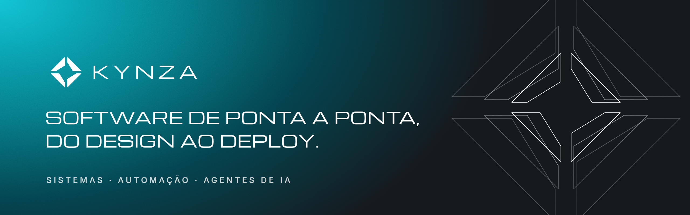
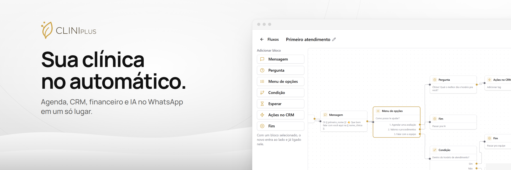

### Oi, eu sou o Felipe Almeida

Desenvolvedor full-stack há mais de 5 anos, fundador e CEO da **[Kynza](https://github.com/kynzabr)** e cofundador do **[CliniPlus](https://app.meucliniplus.com.br)**.

Construo aplicações web de ponta a ponta: produto, interface, API, banco, pagamentos, automações e IA. Comecei pelo frontend, passei por agência e universidade, e hoje atendo empresas pela Kynza, minha software house, enquanto construo o CliniPlus. Saí de Bagé, no interior do RS, e moro em Balneário Camboriú, SC.

Técnico em Informática pelo IFSul, cursando Engenharia de Software.

---

#### Trajetória

| Quando | O quê | Onde |
| --- | --- | --- |
| atual | **Cofundador** do CliniPlus, à frente do produto e da tecnologia | Balneário Camboriú, SC |
| 2025 – atual | **Fundador e CEO da [Kynza](https://github.com/kynzabr)**: sistemas, automações (n8n, Evolution API, Stays API) e agentes de IA para empresas como HUBGPS, BERSEBAHOSTS e DESBRAVA.AI | remoto |
| 2024 – 2025 | **Desenvolvedor full-stack pleno** | Insight Marketing Digital, PJ |
| 2023 – 2024 | **Estagiário de desenvolvimento** | UERGS, Bagé, RS |
| 2021 – 2022 | **Desenvolvedor frontend** | Elliptic Technology, remoto |

Projetos que entreguei nesse caminho: landing pages, e-commerces, sistemas web e APIs, entre eles Atrium, Boa de Venda, Solvee e Pitupi.

---

#### Agora: Kynza

<a href="https://github.com/kynzabr">
  
</a>

A Kynza é a minha software house. Desenvolvemos sistemas sob medida, automações e agentes de IA, do diagnóstico ao deploy. Já são mais de 40 empresas atendidas.

- Agentes de IA no WhatsApp, por texto e voz, integrados ao CRM
- Automação de processos com n8n, APIs e integrações
- Sistemas web e SaaS multi-tenant, com assinaturas e pagamentos
- Até 70% menos tempo em tarefas manuais dos clientes

[github.com/kynzabr](https://github.com/kynzabr) · [@kynzabr](https://instagram.com/kynzabr)

---

#### Também: CliniPlus

<a href="https://app.meucliniplus.com.br">
  
</a>

SaaS pra clínicas com agenda, CRM, financeiro e IA no WhatsApp em um só lugar. Fundei com a minha sócia e cuido do produto: desenvolvimento e suporte.

- Chatbot de atendimento com editor visual de fluxos
- IA que atende o WhatsApp fora do horário e passa pra equipe quando precisa
- Agenda com lembretes e confirmação automática
- CRM com funil, tags, tarefas e automações por fila
- Cobrança recorrente com Stripe

```
0$ 🟩⬜⬜⬜⬜⬜⬜⬜⬜⬜ 10K$/MRR
```

O código é privado. Conto o caminho em público no X: [@fgalmeida_](https://x.com/fgalmeida_)

---

#### Stack

**Front:**


**Back e dados:**


**Pagamentos, automação e IA:**


**Design:**


---

#### Contato

[](https://x.com/fgalmeida_)
[](https://linkedin.com/in/fgalmeidaa)
[](https://fgalmeida.com)
[](https://fgalmeida.com/links)
[](https://github.com/kynzabr)
[](https://instagram.com/fgalmeida_)
